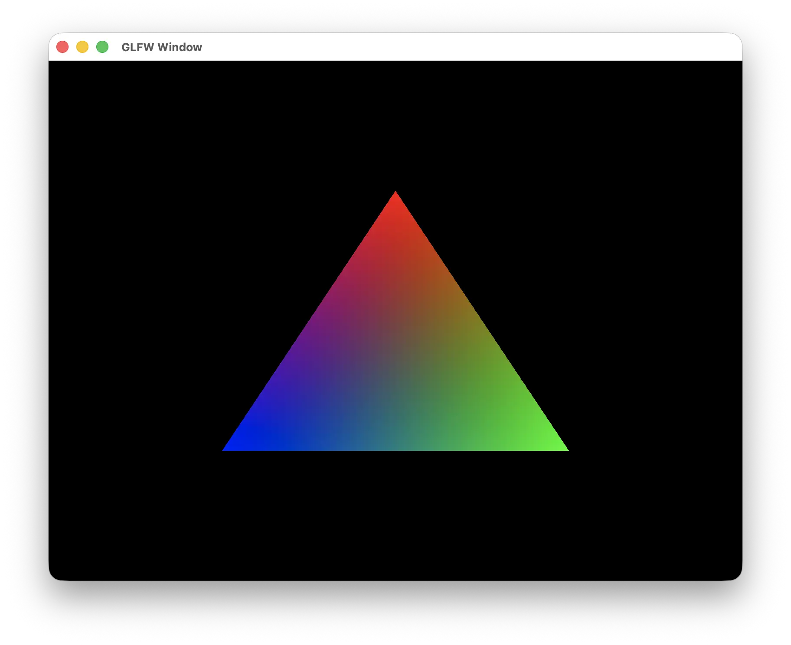
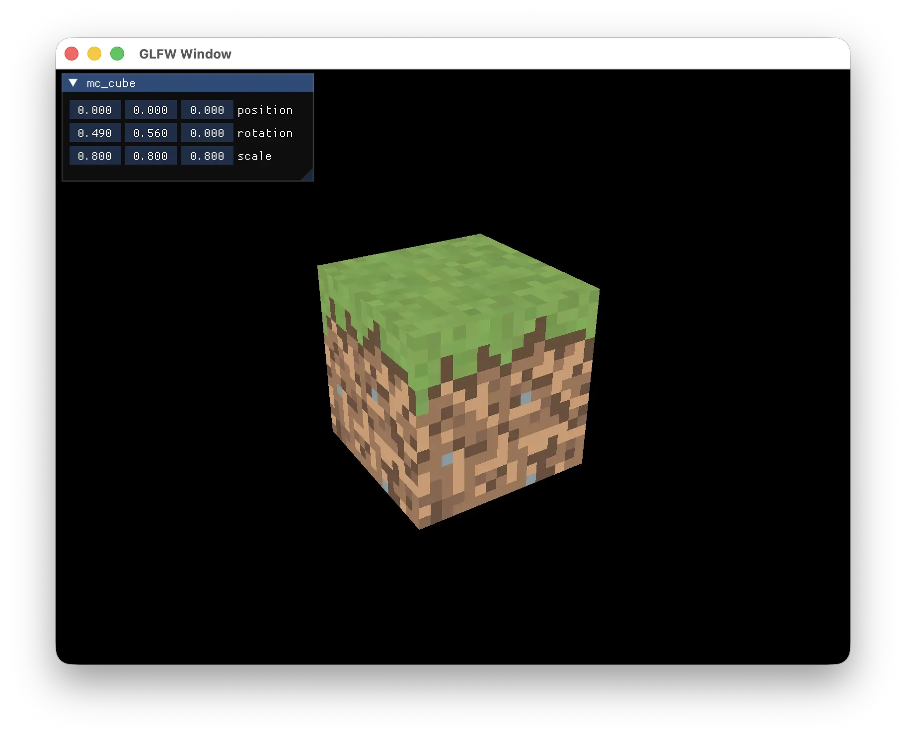
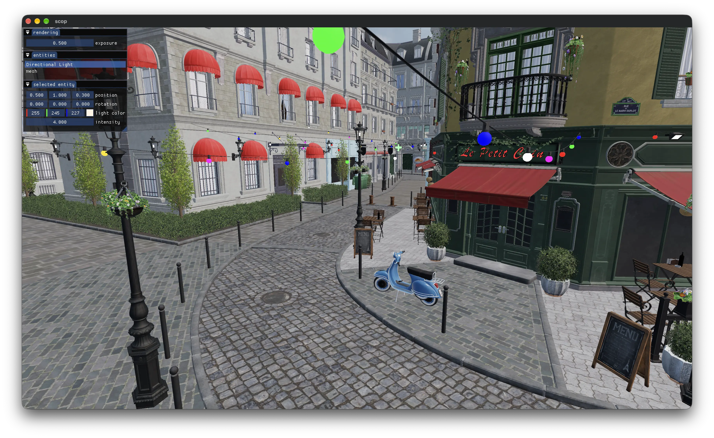
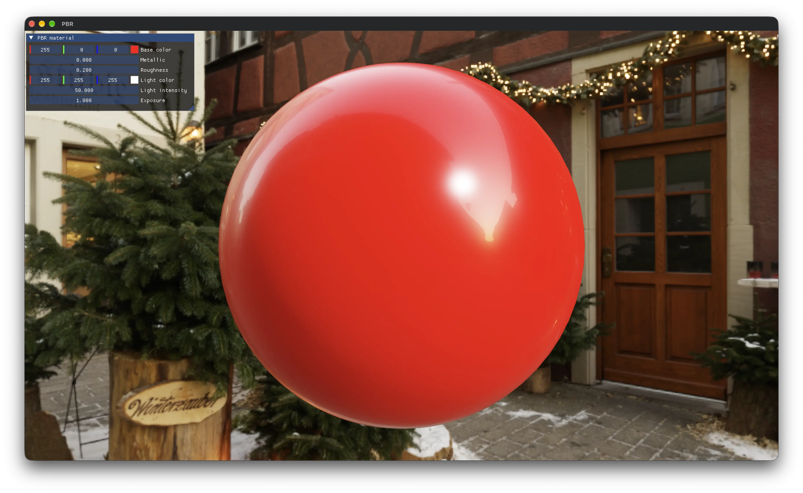

Graphics
========

**Graphics** is a C++23 abstraction layer over Metal and Vulkan for rendering and GPU compute. I use it in my graphics-related projects and as a place to experiment with new rendering techniques.

Platform Support
----------------

| Platform | Metal | Vulkan |
|----------|-------|--------|
| macOS    | [](https://github.com/Thomas-Chqt/Graphics/actions/workflows/macos-metal.yml) | [](https://github.com/Thomas-Chqt/Graphics/actions/workflows/macos-vulkan.yml) |
| Windows  | N/A | [](https://github.com/Thomas-Chqt/Graphics/actions/workflows/windows.yml) |
| Linux    | N/A | [](https://github.com/Thomas-Chqt/Graphics/actions/workflows/linux.yml) |

Features
--------

- **Runtime backend selection**: Choose Metal or Vulkan from the same application when both backends are built. Switching requires recreating the instance and its associated device and resources
- **Automatic synchronization**: All resources are tracked inside and across command buffers, with barriers and semaphores inserted automatically when necessary
- **Resource lifetime management**: RAII and shared ownership keep resources referenced by recorded commands alive, including staging buffers used for uploads
- **Optional integrations**: GLFW, ImGui, and Tracy support live in separate integration libraries. Build and link only the integrations you use, and provide the corresponding external libraries from your own project
- **Compute shaders**: Compute pipelines and passes with GPU threadgroup dispatch, structured buffers, and writable storage textures
- **Mipmaps and texture views**: Generate mipmaps, use mipmapped sampling, and create views selecting mip levels and array layers, including cubemap views

Build
-----

CMake is used as the build system. The recommended way to use the library is to include it in your project with CMake's FetchContent. It can also be built separately.

To build the library and all examples in Release mode:

```sh
cmake -S . -B build -DCMAKE_BUILD_TYPE=Release -DGFX_BUILD_EXAMPLES=ON
cmake --build build --config Release
```

CMake uses FetchContent for build dependencies. The Vulkan loader, MoltenVK, and Metal framework are system dependencies; see [Dependencies](#dependencies). Applications using the optional integrations must also provide and link the corresponding external libraries.

### CMake Options

| Option | Default | Description |
|--------|---------|-------------|
| `GFX_BUILD_METAL` | `ON` | Build the Metal backend (macOS only) |
| `GFX_BUILD_VULKAN` | `ON` | Build the Vulkan backend |
| `GFX_BUILD_IMGUI_INTEGRATION` | `ON` | Build the `GraphicsImGui` integration library |
| `GFX_BUILD_GLFW_INTEGRATION` | `ON` | Build the `GraphicsGLFW` integration library |
| `GFX_BUILD_TRACY_INTEGRATION` | `ON` | Build the `GraphicsTracy` integration library |
| `GFX_BUILD_EXAMPLES` | `OFF` | Build the example executables |
| `GFX_INSTALL` | `ON` | Enable the CMake install command |

Example targets are only added when their required integration targets are enabled.

Examples
--------

- **triangle**: Demonstrates the most basic code required to render a triangle



- **mc_cube**: Demonstrates more advanced usage such as constant buffers and textures



- **scop**: The most advanced example, showcasing the latest library features, including PBR, with a 3D renderer that supports loading models and materials using Assimp



- **pbr**: Demonstrates metallic/roughness physically based rendering with HDR environment lighting and compute-generated irradiance cubemaps, prefiltered environment maps, and a BRDF lookup texture



Dependencies
------------

### System dependencies

- **Vulkan loader**: Required at runtime. On Windows and Linux, it is normally installed with GPU drivers. On macOS, the `vulkan-loader` and `molten-vk` Homebrew packages provide the Vulkan runtime. Vulkan functions are loaded dynamically, so the library can build without the loader installed. For a Metal-only build on macOS, use `-DGFX_BUILD_VULKAN=OFF`
- **Metal framework and toolchain**: Required for the Metal backend and shader compilation. Install a missing Metal toolchain from Xcode's Components settings or with `xcodebuild -downloadComponent MetalToolchain`

### Build dependencies

These dependencies do not need to be installed manually; CMake automatically fetches them if they are not already available.

- **[Vulkan-Headers](https://github.com/KhronosGroup/Vulkan-Headers)**: Vulkan API headers, including Vulkan-Hpp, for the Vulkan backend
- **[Slang](https://github.com/shader-slang/slang)**: Common shader language and compilation API used by `gfxsc` to build shaders

### Integrations and examples

Build and link the integration targets you use, and provide the corresponding external libraries from your application:

| Integration target | External library |
|--------------------|------------------|
| `GraphicsGLFW` | [GLFW](https://github.com/glfw/glfw) |
| `GraphicsImGui` | [Dear ImGui](https://github.com/Thomas-Chqt/imgui) |
| `GraphicsTracy` | [Tracy](https://github.com/wolfpld/tracy) |

For Tracy, include `<tracy/Tracy.hpp>` before `<gfx_tracy/gfx_tracy.hpp>`.

Some examples also use **[stb_image](https://github.com/Thomas-Chqt/stb_image)** for loading textures and **[Assimp](https://github.com/assimp/assimp)** for importing models and meshes.
